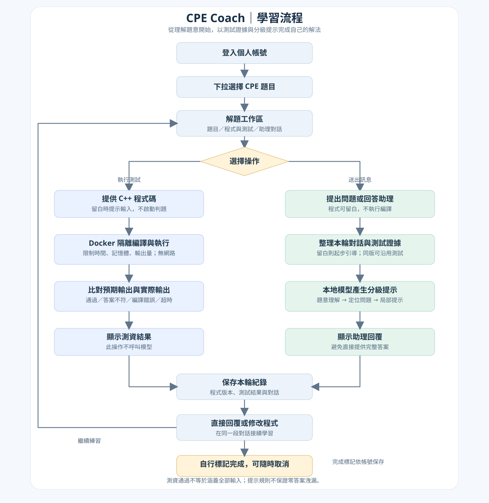

# CPE Coach

以本地大型語言模型與實際 C++ 判題證據，提供逐步提示的 CPE 學習輔導網站。目標是協助學生理解與修正自己的程式，而不是直接產生整題答案。

## 專案流程圖



[查看完整流程圖](docs/FLOWCHARTS.md)：包含使用者流程、系統架構、測試與詢問分流、連續對話，以及十題 QLoRA 訓練。

## 功能

- 十題 CPE 一星選集，下拉選題與個人完成進度。
- 程式可留白，從題意、手算與小問題開始引導。
- 連續對話：回覆助理時不必離開解題頁，不同練習各自保存。
- 「送出訊息」與「執行測試」分開，避免每次對話都重新編譯。
- Docker 隔離的 C++17 編譯、測資執行與預期輸出比對。
- 程式與全部測資一致時，詢問可沿用同一段對話的測試結果並標記來源。
- 三欄深色工作區、離線語法編輯器、響應式頁籤與失敗測資優先展開。
- Qwen3-4B-Instruct-2507 的 NF4 推論，以及十題 QLoRA 試訓流程。

## 快速啟動：不需要 GPU 的示範模式

建議 Python 3.12。先將 repository clone 到電腦並進入其根目錄，在 PowerShell 執行：

```powershell
python -m venv .venv
.\.venv\Scripts\python.exe -m pip install -r requirements.txt
.\.venv\Scripts\python.exe manage.py migrate
.\.venv\Scripts\python.exe manage.py seed_cpe10
.\.venv\Scripts\python.exe manage.py createsuperuser
.\.venv\Scripts\python.exe manage.py runserver 127.0.0.1:8000
```

開啟 [本地網站](http://127.0.0.1:8000)，以剛建立的帳號登入。沒有預設帳號或密碼。預設 `HINT_MODE=demo`，回傳固定示範提示，不會分析實際程式。`seed_cpe10` 只新增題目，不覆寫既有資料。`seed_problems` 是早期三題自編範例，目前不出現在 CPE 題庫。

Linux/macOS 的虛擬環境 Python 路徑為 `.venv/bin/python`；模型訓練與 Windows GPU 相依套件另行配置。

## 啟用 C++ 判題

先安裝並啟動 Docker Desktop 的 Linux containers，確認 `docker version` 同時顯示 Client 和 Server，再於專案根目錄執行：

```powershell
docker build -t cpe-judge:local ./judge
```

網站會用容器執行程式，不會直接在宿主機執行學生 C++。容器停用網路、限制 CPU/記憶體/程序數/輸出量與執行時間。沒有 Docker 或引擎未就緒時會顯示環境狀態，不會退回宿主機執行。

詳細限制及測資比較方式見 [編譯與測資功能](編譯與測資功能.md)。這是本機專題用隔離機制，不是經過對抗性驗證的公開線上 judge。

## 接入 Qwen3 本地模型

使用具 CUDA 支援的獨立 Python 環境。以下命令需在已安裝相容 CUDA PyTorch 的環境中執行；不要在網站示範環境中任意混裝不同版 PyTorch。

```powershell
python -m pip install -r requirements.txt -r requirements-model.txt
python -m pip install huggingface_hub
hf download Qwen/Qwen3-4B-Instruct-2507 --local-dir ./models/Qwen3-4B-Instruct-2507
$env:HF_MODEL_PATH = "$PWD\models\Qwen3-4B-Instruct-2507"
python local_model_server.py
```

另一個 PowerShell，在同一個環境與專案根目錄啟動網站：

```powershell
$env:HINT_MODE = 'live'
$env:Model_URL = 'http://127.0.0.1:11436'
$env:Model_Name = 'Qwen3-4B-Instruct-2507'
$env:CONTEXT_TOKENS = '4096'
python manage.py runserver 127.0.0.1:8000
```

`Model_URL` 與 `Model_Name` 分別設定模型服務網址與模型名稱；實際呼叫的是本專案的 Hugging Face 推論服務，不需要另外安裝 Ollama。服務以 4-bit NF4 載入本地權重，使用實際 tokenizer 檢查上下文，不裁切本輪程式碼。

相依套件需配合 GPU、驅動、PyTorch/CUDA 與 Python 版本。RTX 5060 8GB 已完成本專案試訓，但不能保證任意版本組合均可直接執行。原機操作紀錄見 [模型接入說明](接入已下載模型.md)，其中個人路徑需自行調整。設定讀取環境變數，**不會自動載入 `.env`**。

## 十題微調實驗

基礎模型為 [Qwen3-4B-Instruct-2507](https://huggingface.co/Qwen/Qwen3-4B-Instruct-2507)。以自行撰寫、經 Docker 驗證的程式與錯誤變體，建立 90 筆訓練對話、30 筆同題不同錯誤類型的評估對話。

- 訓練一個 epoch、23 次參數更新，rank 8 QLoRA。
- 原機 PyTorch 最高配置 GPU 記憶體約 5.53 GiB。
- 10 筆保留案例的平均 assistant loss：7.28 → 2.37。
- 評估題目仍是訓練見過的十題；loss 不代表診斷正確率或學習成效。
- 回覆抽查仍有提示過於籠統的案例。此為試驗模型，不宣稱已完整學會十題。

[訓練流程](training/README.md) · [實驗說明與限制](training/本輪訓練結果.md) · [訓練報告](training/reports/cpe10-v1/training_report.json) · [回覆對照](training/reports/cpe10-v1/generation_comparison.json)

模型與 adapter 權重不放進 Git。可依訓練流程重建 adapter，再透過 `HF_ADAPTER_PATH` 載入。原始模型權重不會被覆寫。題目摘要、程式、測資與提示由本專案編寫；原題來源逐題保存在 `training/data/problems.json`，不是官方授權題庫或完整官方題目重刊。

## 專案結構

```text
coach/                 Django 資料模型、流程、判題、權限與測試
config/                網站設定與路由
templates/             題庫與解題工作區
static/                本地編輯器、樣式、對話互動與第三方授權
judge/                 隔離編譯與執行容器
training/data/         自編訓練、評估、題目與實測稽核資料
training/reports/      可追溯的實驗結果
training/              資料建立、QLoRA 與回覆比較程式
```

網站架構參考課堂 Django／FastAPI 分層教材，原教材與校內資料庫、金鑰未納入 repository。本專案使用 SQLite，與校內共用資料庫無關。

## 驗證

```powershell
python manage.py check
python manage.py test coach
```

目前 35 項測試通過，包括帳號隔離、防重送、連續對話、判題結果沿用與失效、完成標記、空白程式引導、頁面與靜態資產。另通過 JavaScript 語法與 Markdown 注入檢查。新版 UI 尚未完成實際瀏覽器視覺與點擊驗證，見 [UI 更新說明](UI更新說明.md)。

## 資料、授權與部署界線

`.gitignore` 排除虛擬環境、模型、adapter、資料庫、`.env`、本地網站密鑰與壓縮檔。首次啟動會建立本機 `.local-secret`，帳號與紀錄只存在本機 SQLite。分享與提交前仍應確認沒有自行新增的敏感資料。

第三方前端元件使用 MIT 授權，授權檔與固定版本來源保存在 [static/vendor](static/vendor/README.md)。Qwen 基礎模型依其官方模型授權使用。Repository 未另行授予本專案原始碼的開源授權。

此版本適合 localhost 開發與課堂展示；`runserver`、本地靜態資產路由與現有 Docker 判題設計不應直接作為公開服務。公開部署需另行規劃正式主機、HTTPS、工作佇列、容量限制、專用沙箱、資料同意與刪除機制。
