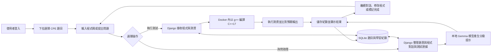

# CPE Coach

結合本地 Gemma 模型與 C++ 編譯測試的 CPE 學習網站，提供 49 題一星題目、分級提示與連續對話。

## 硬體與環境需求

以下以 Windows 本地執行為主；RAM 與磁碟數字為安裝建議，GPU 為本專案實測配置。

| 項目 | 配置 |
|---|---|
| 作業系統 | Windows 11 x64，啟用虛擬化與 WSL 2 |
| CPU | x64 處理器 |
| GPU | 本專案實測 NVIDIA RTX 5060 8GB，使用 CUDA 與 4-bit NF4 |
| RAM | 建議至少 16GB，32GB 較充裕 |
| 磁碟 | 建議預留 30GB，包含約 8.6GB 模型、Python 環境與 Docker 映像 |
| 軟體 | Git、Miniconda、Python 3.12、NVIDIA 驅動、Docker Desktop AMD64 |

## 使用技術

| 部分 | 技術 |
|---|---|
| 網頁介面 | HTML、CSS、JavaScript、Django Templates |
| 程式編輯與訊息呈現 | CodeMirror、markdown-it |
| 網站後端 | Python、Django |
| 資料庫與帳號 | SQLite、Django Authentication |
| 本地模型 | Google Gemma 3 4B IT、Transformers、PyTorch |
| 模型量化 | bitsandbytes、4-bit NF4 |
| 微調 | PEFT、QLoRA |
| 程式測試 | Docker、g++、C++17、stdin/stdout 比對 |
| 網站與模型通訊 | HTTP、JSON |

## 系統流程圖



[查看詳細流程圖](docs/FLOWCHARTS.md)

## 安裝步驟

### 1. 安裝基本軟體

安裝 Git、Miniconda、NVIDIA 驅動與 Docker Desktop。Windows x64 選擇 Docker Desktop 的 AMD64 版本，依安裝程式啟用 WSL 2，並使用 Linux containers。

### 2. 下載專案與建立 Python 環境

在 **Anaconda Prompt** 執行：

```powershell
git clone https://github.com/yuu1026/CPE-Coach.git
cd CPE-Coach
conda create -n cpe-ai python=3.12 pip -y
conda activate cpe-ai
```

### 3. 安裝套件

以下 CUDA PyTorch 版本為本專案實測組合：

```powershell
python -m pip install torch==2.11.0 --index-url https://download.pytorch.org/whl/cu128
python -m pip install -r requirements.txt -r requirements-model.txt huggingface_hub
python -c "import torch; print('CUDA:', torch.cuda.is_available())"
```

確認輸出 `CUDA: True`。

### 4. 下載 Gemma 模型

先使用自己的 Hugging Face 帳號登入 [Gemma 3 4B IT 模型頁](https://huggingface.co/google/gemma-3-4b-it)，同意模型使用條款，再執行：

```powershell
hf auth login
hf download google/gemma-3-4b-it --local-dir ./models/gemma-3-4b-it
```

模型會放在專案的 `models/gemma-3-4b-it`；GitHub 不包含模型與微調 Adapter 權重。

### 5. 建立資料庫、題庫與登入帳號

```powershell
python manage.py migrate
python manage.py seed_cpe49
python manage.py createsuperuser
```

依提示設定網站登入帳號與密碼。

### 6. 建立 C++ 判題環境

開啟 Docker Desktop，等待引擎啟動後執行：

```powershell
docker version
docker build -t cpe-judge:local ./judge
```

`docker version` 應同時顯示 Client 與 Server。映像建置完成後即可執行題目測試。

## 啟動指令

先開啟 Docker Desktop，再於專案根目錄開啟兩個 PowerShell 視窗。

**第一個視窗：啟動模型**

```powershell
.\啟動模型.ps1
```

等待顯示「模型已就緒」。

**第二個視窗：啟動網站**

```powershell
.\啟動網站-真實模型.ps1
```

開啟 [http://127.0.0.1:8000](http://127.0.0.1:8000)，使用安裝時建立的帳號登入。模型服務位於 `http://127.0.0.1:11436`。腳本會自動尋找可用的 Python 環境；停止服務時，在各視窗按 `Ctrl+C`。

### 使用微調實驗版本

本地已有相應 Adapter 時，先停止原本的模型與網站，再於兩個視窗分別執行：

```powershell
# 第一個視窗
.\啟動模型-CPE49實驗.ps1 -Version v2
```

```powershell
# 第二個視窗
.\啟動網站-CPE49實驗.ps1 -Version v2
```

將 `v2` 改成 `v1` 可比較另一版；一般啟動指令使用目前預設的 Gemma 基礎模型。

## 微調實驗數據

基礎模型為 **Google Gemma 3 4B IT**，訓練硬體為 **RTX 5060 8GB**。

| 項目 | 設定／數量 |
|---|---|
| 題目 | 49 題 CPE 一星選集 |
| 訓練對話 | 539 筆：找錯提示、通過回饋、空白起步與連續對話 |
| 評估對話 | 147 筆，相同題目使用不同錯誤程式 |
| Loss 評估 | 其中第一層的 49 筆對話 |
| 程式驗證 | Docker 實測 49 個正確版與 98 個錯誤版 |
| 微調方法 | NF4 QLoRA、rank 8、q_proj／v_proj |
| 每版訓練 | 1 epoch、135 次更新 |
| Batch／梯度累積 | 1／4 |
| 最大序列長度設定 | 2048 tokens |
| PyTorch 配置記憶體峰值 | 約 5.30GiB |

| 版本 | Learning rate | 訓練前 Loss | 訓練後 Loss | 訓練與末次評估時間 |
|---|---:|---:|---:|---:|
| v1 | 0.00005 | 7.8525 | 2.1955 | 約 486 秒 |
| v2 | 0.00001 | 7.8525 | 3.4718 | 約 486 秒 |

時間不含模型載入與訓練前評估。Loss 為 assistant 回覆的平均損失，不等於診斷正確率；評估題目仍是訓練見過的 49 題。兩版保留供實驗比較，網站預設使用 Gemma 基礎模型。

[v1 訓練報告](training/reports/gemma3-cpe49-v1/training_report.json) · [v2 訓練報告](training/reports/gemma3-cpe49-v2/training_report.json) · [回覆比較與判讀](training/reports/cpe49-selection.json)

### 重現微調實驗

在 `cpe-ai` 環境、專案根目錄執行，訓練前先停止模型服務以釋放 GPU：

```powershell
python -m pip install -r training/requirements.txt
python training/train_qlora.py --learning-rate 0.00005 --output training/runs/gemma3-cpe49-v1
python training/train_qlora.py --learning-rate 0.00001 --output training/runs/gemma3-cpe49-v2
python training/compare_outputs.py --adapter training/runs/gemma3-cpe49-v2
```

輸出資料夾若已存在，請改用新的 `--output` 名稱。[完整微調步驟](training/CPE49.md)
