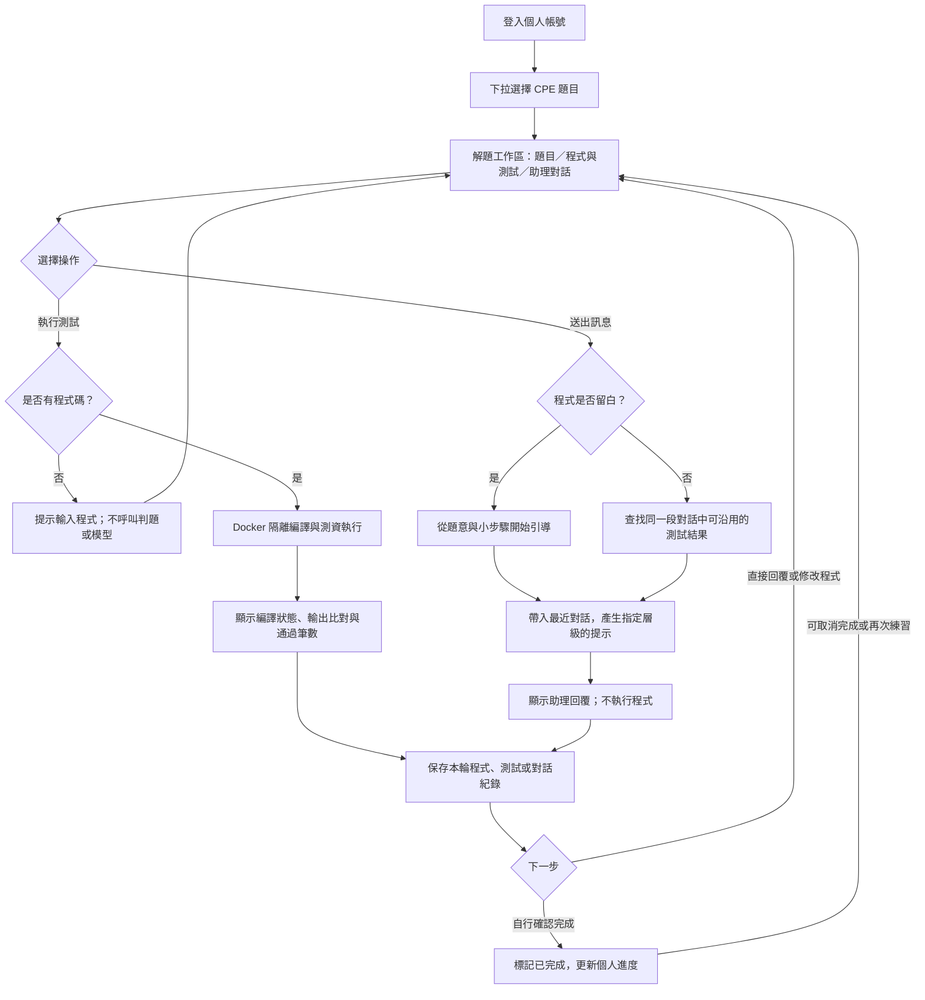
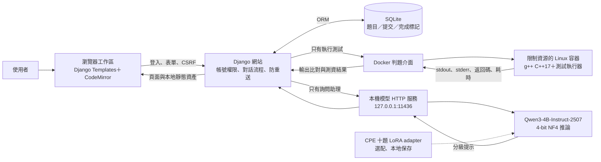
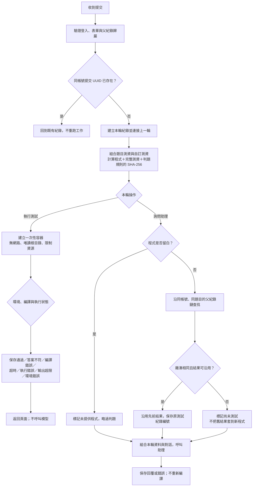
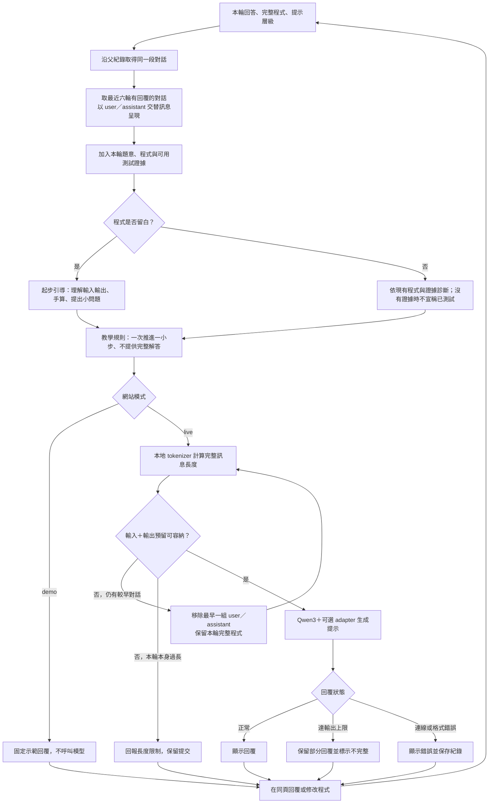
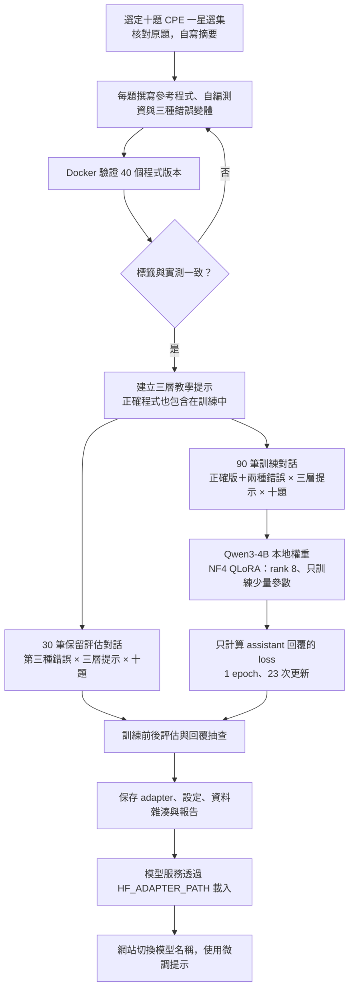

# CPE Coach 專案流程圖

以下依目前程式實作繪製。GitHub 可直接呈現 Mermaid 圖；[學習流程 SVG](diagrams/learning-flow.svg) 可下載放入期中簡報。

## 1. 使用者學習流程

完成標記由使用者自行設定，與測資通過狀態分開。通過本次測資不等於涵蓋全部合法輸入，也不會自動標記完成。

## 2. 系統架構與資料流

模型服務提供本專案相容的 `/api/chat` 介面，使用 Hugging Face Transformers；雖然網站沿用 `OLLAMA_*` 設定名稱，這條路徑不需要 Ollama。Docker 不載入模型，模型也不直接執行學生程式。

## 3. 測試與詢問的分流、結果沿用

可沿用的是 `accepted`、`failed`、`compile_error` 結果。Docker 缺失、環境異常等結果不作為有效測試快取。程式、題目測資、自訂輸入或預期輸出變更都會使雜湊不同。即使模型失敗，測試結果仍保留。

## 4. 連續對話與模型提示

圖中的精確 token 計算與移除較早對話，指本專案本地模型服務。若改接其他後端，目前網站仍保留保守輸入估算。提示規則能降低直接洩漏答案的機率，並非零洩漏保證。

## 5. 十題資料建立與 QLoRA 訓練

本輪 loss 評估使用保留資料中第 1 層的 10 筆，另有六筆原始／adapter 回覆對照。評估題目仍是訓練見過的十題，只保留不同錯誤類型；不可宣稱是未見題目泛化測試。完整結果見 [訓練結果](../training/本輪訓練結果.md) 與 [文字報告](../training/reports/cpe10-v1/training_report.json)。

## 程式對照

| 流程 | 實作位置 |
|---|---|
| 登入、選題、回覆、完成標記 | `coach/views.py` |
| 表單驗證與操作類型 | `coach/forms.py` |
| 防重送、對話鏈、結果沿用與分流 | `coach/workflows.py` |
| Docker 限制與輸出比對 | `coach/judging.py`、`judge/runner.py` |
| 對話組合、分級規則、模型 HTTP 呼叫 | `coach/services.py` |
| Token 長度、歷史縮減與本地推論 | `local_model_server.py` |
| 題庫、提交與個人完成紀錄 | `coach/models.py` |
| 資料建立、訓練與回覆比較 | `training/` |

目前網站與模型呼叫採同步流程，尚未加入背景工作佇列；圖中保存紀錄不代表程序中斷後會自動續跑。
